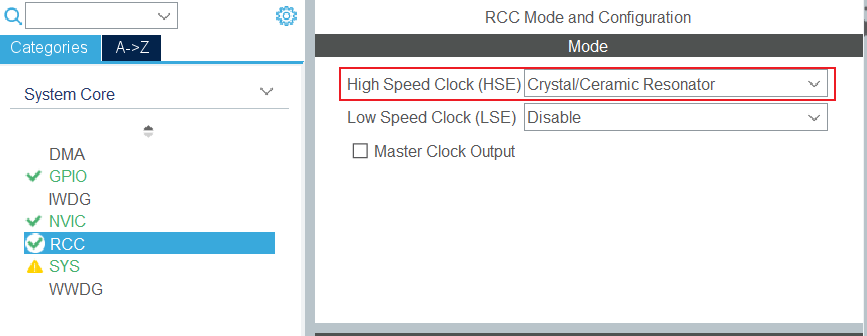
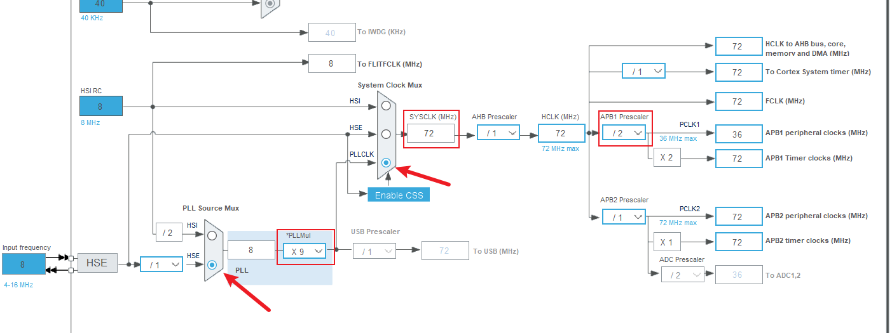
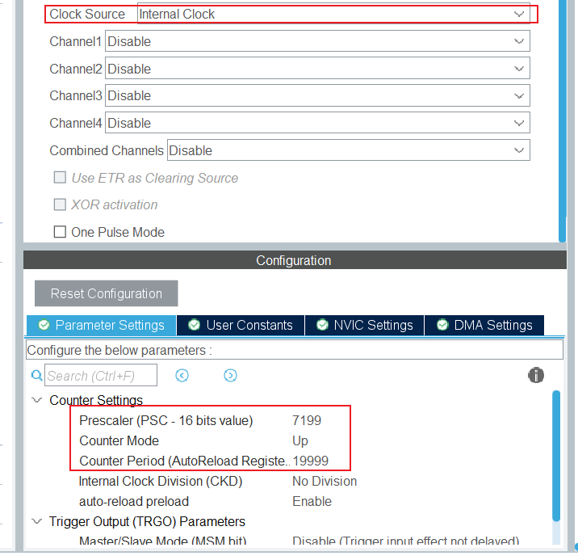
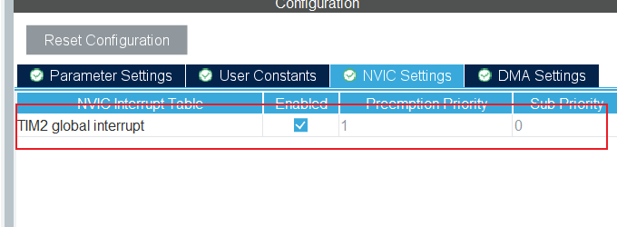
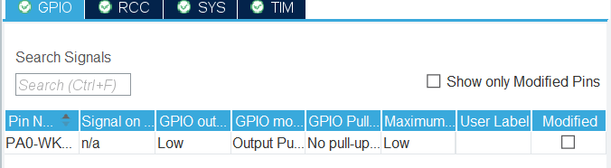
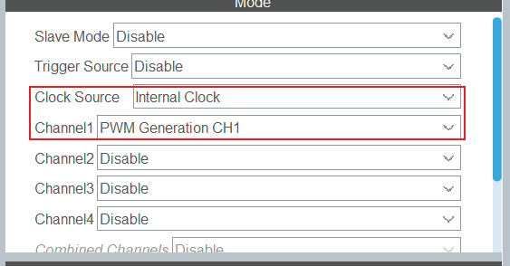
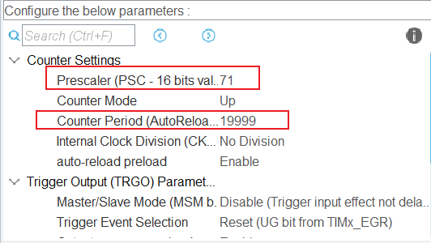
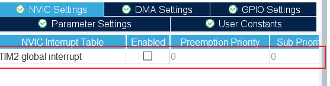
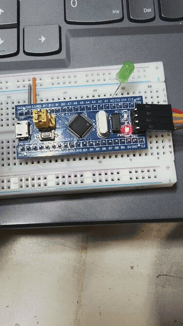
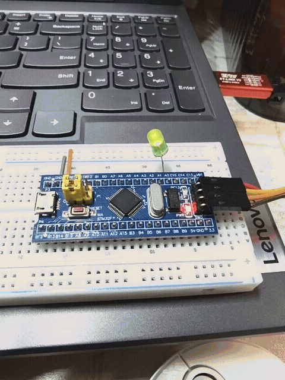

# STM32F103定时器与PWM实验：LED闪烁与呼吸灯实现

  

[TOC]

本实验基于STM32F103C8T6单片机，利用通用定时器TIM完成两项功能：其一，配置定时器计数中断，控制LED以2s周期周期性亮灭；其二，使用定时器PWM输出模式，实现LED呼吸灯效果，通过动态修改PWM占空比完成LED渐亮渐灭，并借助Keil虚拟示波器观测PWM输出波形。实验深入理解STM32通用定时器工作原理、GPIO复用功能以及脉宽调制（PWM）的生成机制，掌握CubeMX工程配置与Keil软件调试方法。

## 一、实验目的

1. 深入理解STM32F103通用定时器（TIM2~TIM5）内部结构、计数原理与中断工作机制。
放原理图
2. 掌握STM32定时器通道GPIO复用功能配置，理解定时器通道引脚与普通GPIO的区别。
3. 掌握定时器PWM输出模式原理，学会配置PWM周期、占空比参数。
4. 实现LED定时闪烁与呼吸灯效果，学会使用Keil虚拟示波器采集、观察PWM波形。

## 二、实验原理

### 2.1 STM32通用定时器基础

STM32F103的TIM2~TIM5属于通用定时器，核心由自动重装载寄存器ARR、预分频器PSC、计数器CNT、捕获比较寄存器CCR组成。

1.预分频器PSC：

对定时器时钟进行分频，降低计数器计数频率；定时器内核时钟APB1，当APB1预分频不为1时，定时器时钟倍频为2倍APB1时钟。

2.计数器CNT：

从0开始向上计数，计数值等于ARR时触发更新事件（溢出），CNT清零重新计数。

3.更新中断：

计数溢出后产生更新中断，进入中断服务函数，可在中断内翻转IO电平，实现固定周期LED闪烁

4.定时时间计算公式：

T~out~=【（PSC+1）*（ARR+1）】/T~TIM_CLK~

### 2.2 PWM脉宽调制原理

  PWM是周期固定、高电平时间可变的方波信号。在定时器PWM输出模式下：

1.ARR：决定PWM信号周期；

2.CCRx：捕获比较寄存器，决定高电平的计数值；

3.占空比：

DUTY(%)=CCR/(ARR+1)*100%。当CNT计数值小于CCRx时，输出指定电平；CNT大于CCRx时，电平翻转。动态修改CCRx的值，就可以连续改变PWM占空比。LED亮度由平均电压决定：占空比越大，平均电压越高，LED越亮；占空比越小，LED越暗。人眼视觉暂留效应下，连续变化占空比即可看到呼吸灯效果。

### 2.3 GPIO复用功能

  定时器通道引脚不是普通GPIO，需要配置为复用推挽输出模式。此时引脚不再受GPIO输出寄存器控制，输出电平由定时器外设直接驱动，实现PWM信号输出。例如TIM2_CH1复用引脚PA0，配置后PA0引脚输出TIM2通道1的PWM波形，外接LED串联电阻到GND。

## 三、实验环境

1.硬件：STM32F103C8T6最小系统板，LED灯

2.软件：STM32CubeMX，Keil MDK5

3.固件库：STM32 HAL库

## 四、实验内容与步骤

本实验选择TIM2，通道1 PA0作为输出引脚。

### 4.1 任务1：定时器中断实现LED 2s周期闪烁

#### 4.1.1 CubeMX工程配置

1.芯片选型：STM32F103C8T6。

2.RCC配置：高速外部时钟HSE，时钟树配置系统时钟72MHz；APB1分频为2，TIM2时钟 = 72MHz。
                     



3.TIM2配置：选择内部时钟源，预分频PSC=7199，自动重装载ARR=19999。
计算：定时器计数频率 = 72M/(7199+1)=10kHz；溢出时间 T=(19999+1)/10000=2s。每2s触发一次新中断，中断内翻转LED电平，完成频率2s周期一亮一灭。
                          

4.NVIC配置：开启TIM2更新中断，设置中断优先级。
                         

5.PA0先作为普通GPIO输出，推挽输出，上拉。
                          

6.生成工程，选择HAL库。

#### 4.1.2 代码编写

1.全局变量

```c
/* USER CODE BEGIN PV */
uint8_t led_state = 0;
/* USER CODE END PV */
```

2.main函数初始化

```c
int main(void)
{
  HAL_Init();//HAL库初始化
  SystemClock_Config();//配置外部高速晶振HSE
  MX_GPIO_Init();
  MX_TIM2_Init();
  HAL_TIM_Base_Start_IT(&htim2); // 启动定时器

```

3.定时器溢出中断回调函数

```c
void HAL_TIM_PeriodElapsedCallback(TIM_HandleTypeDef *htim)
{
  if(htim->Instance == TIM2)
  {
    HAL_GPIO_TogglePin(GPIOA, GPIO_PIN_0);//PA0电平翻转
  }
}
```


#### 4.1.3 现象观察

烧录程序，LED周期性点亮2s、熄灭2s


### 4.2 任务2：TIM PWM模式实现呼吸灯

#### 4.2.1 CubeMX重新配置TIM2

1.TIM2模式选择：PWM Generation CH1。
                                                   

2.保持PSC=71，ARR=19999。
定时器计数频率：72M/(71+1)=1MHz，PWM周期 T=(19999+1)/1M=2ms，PWM频率2kHz。



3.PA0自动变为复用推挽输出模式，由TIM2通道1驱动PWM波形。

4.关闭TIM更新中断，生成工程。



#### 4.2.2 呼吸灯逻辑设计

1.PWM周期固定1ms，在主循环中动态修改CCR值：

CCR从0逐步增加到ARR（19999）：占空比从0到100%，LED渐亮；CCR到达最大值后，从19999逐步减小到0：占空比从100%到0，LED渐暗；循环往复，构成呼吸效果。
单次完整呼吸周期约2s，可通过延时调整变化速度。

2.代码编写 

①全局变量

```c
/* USER CODE BEGIN PV */
uint16_t pwm_duty = 0;   // PWM比较值（占空比）
int8_t dir = 1;         
/* USER CODE END PV */

```

②添加函数声明

```c
/* USER CODE BEGIN PFP */
void HAL_Delay_us(uint32_t us);  
/* USER CODE END PFP */
```

②main函数

```c
int main(void)
{
  HAL_Init();
  SystemClock_Config();
  MX_GPIO_Init();
  MX_TIM2_Init(); 
  // 启动TIM2通道1的PWM输出
  HAL_TIM_PWM_Start(&htim2, TIM_CHANNEL_1);
```

③while循环

```c
    pwm_duty += dir;
    if(pwm_duty >= 19999) dir = -1;
    else if(pwm_duty <= 0) dir = 1;
    __HAL_TIM_SET_COMPARE(&htim2, TIM_CHANNEL_1, pwm_duty);
    HAL_Delay_us(40);
```

④微秒时延函数

```c
/* USER CODE BEGIN 4 */
void HAL_Delay_us(uint32_t us)
{
  uint32_t tickstart = SysTick->VAL;
  uint32_t delay = us * (SystemCoreClock / 1000000U);
  while((tickstart - SysTick->VAL) < delay);
}
/* USER CODE END 4 */
```


#### 4.2.3 Keil虚拟示波器观测PWM波形

1.在Keil调试模式下，打开Logic Analyzer。

2.添加观测变量 PORTA.0，设置采样参数。

3.运行程序，实时捕获PWM波形：波形周期固定，高电平宽度随程序变化，直观看到占空比连续增大、减小，对应LED呼吸效果。


##  五、实验结果

1.定时器中断闪烁实验：LED稳定按照2s频率周期，亮2s、灭2s，定时器更新中断工作正常，定时计算与理论一致。



2.PWM呼吸灯实验：LED平滑渐亮、渐暗，无明显频闪；Keil虚拟示波器捕获PWM方波，波形周期不变，脉冲宽度随程序线性增减，验证PWM原理。

​                                                                             

## 六、实验分析与问题讨论

### 6.1 定时参数计算要点

定时器时钟来源容易出错：APB1预分频大于1时，通用定时器时钟会自动倍频，若直接使用APB1时钟计算，会造成定时时间不准。

### 6.2 闪烁与PWM两种方式对比

1.定时器中断翻转IO：

输出是高低电平，只有两种状态，适合简单定时开关；CPU在中断中执行翻转操作。

2.PWM复用输出：

定时器硬件直接输出波形，不需要CPU持续干预，CPU仅需要修改CCR值；可以实现连续亮度调节。


### 6.3 呼吸灯频闪问题

PWM频率过低会肉眼看到闪烁，本实验设置PWM频率2kHz，高于人眼闪烁感知阈值，灯光过渡顺滑。

### 6.4 常见故障排查

1.LED不亮：

检查GPIO模式，PWM模式下引脚必须为复用推挽输出，不能配置成普通GPIO；检查限流电阻，硬件接线。

2.PWM波形看不到：

Keil虚拟示波器要进入调试模式，添加正确寄存器变量，开启实时刷新。

3.呼吸灯变化过快：

增大 HAL_Delay() 延时；变化过慢则减小延时。

## 七、实验总结

本次实验使用 STM32F103C8T6 的通用定时器 TIM2，完成了两个任务：用定时器更新中断实现 LED 周期性闪烁，以及利用定时器 PWM 输出制作呼吸灯。通过实验，我理解了预分频器 PSC、自动重装载寄存器 ARR 的作用，也学会了定时周期的计算方法，分清了普通 GPIO 输出和定时器复用推挽输出的区别。

定时器中断方式依靠中断触发，CPU 在中断回调函数里翻转 IO 电平，只能输出高低两种电平，适合简单的定时开关控制。而 PWM 模式是定时器硬件直接输出方波，CPU 不用一直控制引脚电平，只需要不断修改捕获比较寄存器 CCR 的值，就能改变 PWM 占空比。依靠人眼的视觉暂留效应，LED 就可以呈现平滑的亮度变化，用数字信号模拟出连续可调的模拟量效果。

实验里我使用 Keil 虚拟示波器观察 PWM 波形，直观看到 PWM 周期保持不变，高电平脉冲宽度随着 CCR 数值线性增减。整个过程熟悉了 CubeMX 工程配置、HAL 库定时器代码编写以及软件仿真调试的方法。这次实验加深了我对通用定时器、GPIO 复用功能和 PWM 原理的理解，也为后面电机调速、数字转模拟输出这类嵌入式项目积累了经验。